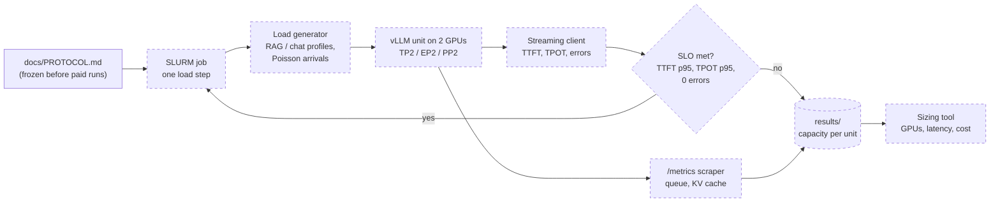
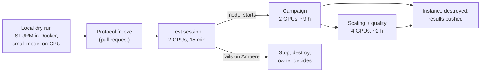

# hpc-inference-sizing

[](https://github.com/gabrielkpo/hpc-inference-sizing/actions/workflows/ci.yml)
[](LICENSE)

Size the GPU fleet that serves an open-weight LLM for a client, from **measurements on real
multi-GPU hardware**: how many GPUs a latency target needs, and what latency a fixed GPU budget
gives. Model: Mistral Small 4 (MoE, 119B parameters), served with vLLM on a rented 2-GPU node.

> **Status: framing done, no measurement yet (step 1 of 7), expect breaking changes.** The
> measurement protocol is written and will be frozen before the first paid GPU run. See
> [Status / Roadmap](#status--roadmap).

## Why

An organisation that hosts a model on its own GPUs must size the hardware before it buys or
reserves it. Too few GPUs and the assistant is too slow to be used; too many and idle cards cost
tens of thousands of euros a year. Vendor benchmarks report peak throughput on their best
hardware, which answers neither question a client actually asks:

- a **public administration** buying GPUs for a document assistant used by 20,000 agents:
  *how many GPUs, at minimum, for a first token in under 2 s, and what does 1 s cost?*
- a **defence ministry** with a fixed, isolated fleet: *with 8 GPUs, what latency do users get,
  and how many can work at once before it breaks?*

Both clients are fictional, modelled on public cases of in-house LLM deployments; their sizes
are proposals until the protocol is frozen ([§3.2](docs/PROTOCOL.md#32-arrivals-and-users)). This project
answers both from one measured quantity: the **capacity of a serving unit under a latency
target**.

## How it works

Measurement path. Dashed boxes are designed in [`docs/PROTOCOL.md`](docs/PROTOCOL.md) and not
built yet.



Campaign lifecycle: nothing is rented until the same jobs have run locally.



**Technical choices and their trade-offs**

- **Mistral Small 4 rather than Mistral Small 3.2 (24B dense)**: it is the current model, and its
  70.8 GB of NVFP4 weights do not fit on one 48 GB card, so multi-GPU is required rather than
  optional. The cost: FP4 runs through weight-only fallback kernels on Ampere, untested end to end
  for this model. See [ADR 0001](docs/adr/0001-mistral-small-4-on-two-a40.md).
- **2 × A40 on Vast.ai rather than H100s or a managed cluster**: about 1 $/h for 96 GB of GPU
  memory on one PCIe 4.0 node keeps the whole study under 20 €. The numbers will not match an
  H100 node; the method and the trade-offs will.
- **Capacity under an SLO rather than peak throughput**: a client buys latency, not tokens per
  second. Peak throughput is reached with queues no user would accept.
- **Measure one unit, extrapolate, then check on 4 GPUs** rather than measuring every fleet size:
  the budget allows one 4-GPU check, which is where the extrapolation is most likely to break.
- **SLURM jobs on a single node** rather than a plain script: the same `sbatch` files run on a
  local Docker cluster first and on the rented node next, so the dry run tests the real path.
  See [ADR 0002](docs/adr/0002-slurm-jobs-local-and-rented.md).
- **Protocol frozen before the first paid run**: hypotheses and pass criteria are written first,
  and refuted hypotheses are published like confirmed ones.

## Example

Illustrative output of the planned sizing tool. **The numbers below are placeholders, not
measurements.**

```text
$ hpc-sizing plan --client administration --users 2000 --think-time 60 --ttft 2 --price 1.10

Peak load        2,000 active users / (60 s think + ~3 s answer)  ->  ~32 req/s
Best unit        EP2 (2 x A40), RAG profile, TTFT p95 <= 2 s
Unit capacity    <measured> req/s
GPUs needed      <units> x 2
Monthly cost     <GPUs> x 1.10 $/h x 730 h
Price of latency TTFT 3 s: <GPUs>   2 s: <GPUs>   1 s: <GPUs>
```

## Status / Roadmap

| Step | Content | State |
|---|---|---|
| 1 Framing | Clients, model, hardware, budget, [protocol](docs/PROTOCOL.md) and decision records | in review |
| 2 Memory model | Weights and MLA KV cache per GPU for each split, tested | planned |
| 3 Bench | Load generator, streaming client, SLO sweep, `/metrics` scraper, tested against a small local model | planned |
| 4 Local dry run | SLURM cluster in Docker, campaign jobs, resume, results saved | planned |
| 5 Test session | Model starts on 2 × A40, one short ladder, instance destroyed | planned |
| 6 Campaign | 2-GPU matrix, then 4-GPU scaling and quality check | planned |
| 7 Sizing and report | Sizing tool, price-of-latency curve, results in this README | planned |

**Evaluation plan.** Six hypotheses with pass criteria written before any run (thresholds
proposed, frozen with the protocol)
([protocol §7](docs/PROTOCOL.md#7-hypotheses-and-pass-criteria)): the price of latency is
non-linear (H1), the best way to split the model depends on the latency target (H2), tuning
vLLM parameters adds at least 20 % capacity (H3), two units deliver at least 1.8 × one unit
(H4), NVFP4 loses at most 2 F1 points against FP8 on 200 PIAF questions (H5), and the memory
model predicts vLLM's KV-cache capacity within 10 % (H6). Capacity points are repeated 3 times;
the median and range are reported.

## Run it

Prerequisites: Python 3.12 and [uv](https://docs.astral.sh/uv/). Nothing is downloaded and no
GPU is needed at this stage.

```bash
git clone https://github.com/gabrielkpo/hpc-inference-sizing.git
cd hpc-inference-sizing
uv sync --group dev
uv run pytest
```

GPU runs will read `VAST_API_KEY` and `HF_TOKEN` from the environment (see `.env.example`).

## Project structure

| Path | Content |
|---|---|
| `docs/PROTOCOL.md` | Question, workload, SLO, configurations, hypotheses, stop rules |
| `docs/adr/` | Decision records: model and hardware, SLURM on one node |
| `src/hpc_inference_sizing/` | Python package (memory model, bench and sizing tool to come) |
| `tests/` | pytest suite |

## Data and privacy

No personal data. Prompts are built from **PIAF** (built by Etalab, `AgentPublic/piaf`, MIT
licence), a public French question-answering dataset, downloaded at run time and not committed. Model weights are
downloaded on the rented node only. API keys live in the environment, never in the repository;
gitleaks scans the full history on every pull request.

## Limitations / next

- **One GPU class, one host.** A40s over PCIe 4.0; results do not transfer as numbers to H100 or
  B200 nodes with NVLink.
- **Ampere has no FP4 tensor cores.** NVFP4 runs weight-only through Marlin kernels, slower than
  on Blackwell. If the model does not start on Ampere, the fallback (Blackwell GPUs, reduced
  matrix) is decided by the owner, not by a script.
- **Synthetic traffic.** Poisson arrivals with fixed lengths are smoother than real peaks.
- **Single node.** Units on separate machines, smart routing and autoscaling are out of scope;
  a written section will cover when several machines are worth it.

## Development

```bash
uv sync --group dev
uv run pre-commit install      # ruff (through uv) and gitleaks on every commit
uv run ruff check . && uv run ruff format --check . && uv run pytest
```

Every change goes through a pull request with a Conventional Commits title, after
`/security-review` and `/code-review`; `main` is protected and merged by squash. CI runs ruff,
pytest, a full-history gitleaks scan, CodeQL and a PR title check. Releases are cut by
release-please (changelog and `vX.Y.Z` tags) from the Conventional Commits on `main`.

## License

[MIT](LICENSE). Model weights are Mistral AI's, under Apache 2.0; PIAF questions are under MIT.
