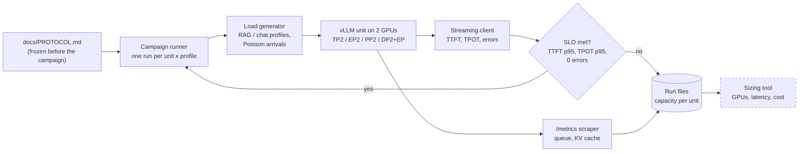
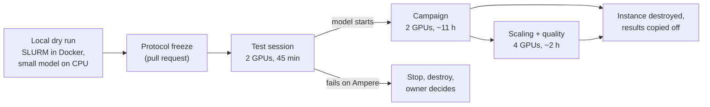

# hpc-inference-sizing

[](https://github.com/gabrielkpo/hpc-inference-sizing/actions/workflows/ci.yml)
[](LICENSE)

Size the GPU fleet that serves an open-weight LLM for a client, from **measurements on real
multi-GPU hardware**: how many GPUs a latency target needs, and what latency a fixed GPU budget
gives. Model: Mistral Small 4 (MoE, 119B parameters), served with vLLM on rented 2- and 4-GPU nodes.

> **Status: measurements done, step 7 of 7 in progress.** The protocol was frozen on 2026-11-11
> ([`docs/PROTOCOL.md`](docs/PROTOCOL.md), with dated amendments). The 2-GPU campaign ran on
> 2026-11-11 and 12 (18 runs, no error, 13.81 USD) and the 4-GPU session on 2026-11-12 (4 runs,
> 7.13 USD); the results are in [`docs/RESULTS.md`](docs/RESULTS.md), and the sizing tool answers
> both clients from them. See [Status / Roadmap](#status--roadmap).

## Why

An organisation that hosts a model on its own GPUs must size the hardware before it buys or
reserves it. Too few GPUs and the assistant is too slow to be used; too many and idle cards cost
tens of thousands of euros a year. Vendor benchmarks report peak throughput on their best
hardware, which answers neither question a client actually asks:

- a **public administration** buying GPUs for a document assistant used by 20,000 agents:
  *how many GPUs, at minimum, for a first token in under 2 s, and what does 1 s cost?*
- a **defence ministry** with a fixed, isolated fleet: *with 8 GPUs, what latency do users get,
  and how many can work at once before it breaks?*

Both clients are fictional, modelled on public cases of in-house LLM deployments; their sizes
were fixed when the protocol was frozen ([§3.2](docs/PROTOCOL.md#32-arrivals-and-users)). This project
answers both from one measured quantity: the **capacity of a serving unit under a latency
target**.

## How it works

Measurement path. Dashed boxes are not built yet.



Campaign lifecycle: nothing is rented until the same jobs have run locally.



**Technical choices and their trade-offs**

- **Mistral Small 4 rather than Mistral Small 3.2 (24B dense)**: it is the current model, and its
  70.8 GB of NVFP4 weights do not fit on one 48 GB card, so multi-GPU is required rather than
  optional. The cost: FP4 runs through weight-only fallback kernels on Ampere, untested end to end
  for this model. See [ADR 0001](docs/adr/0001-mistral-small-4-on-two-a40.md).
- **2 × A40 on Vast.ai rather than H100s or a managed cluster**: 1.2 to 1.5 $/h for 96 GB of GPU
  memory on one PCIe 4.0 node keeps the whole study near 20 € (about 23 USD planned). The numbers will not match an
  H100 node; the method and the trade-offs will.
- **Capacity under an SLO rather than peak throughput**: a client buys latency, not tokens per
  second. Peak throughput is reached with queues no user would accept.
- **Measure one unit, extrapolate, then check on 4 GPUs** rather than measuring every fleet size:
  the budget allows one 4-GPU check, which is where the extrapolation is most likely to break.
- **SLURM for the local dry run, one chained process on the rented node**: the campaign runner
  and its job array ran first on a local SLURM cluster in Docker; on the rented node the matrix
  runs as one `campaign run --chain` process, because the levers and repeats depend on earlier
  runs. See [ADR 0002](docs/adr/0002-slurm-jobs-local-and-rented.md) and
  [ADR 0003](docs/adr/0003-campaign-runs-as-one-chained-process.md).
- **Protocol frozen before the campaign**: hypotheses and pass criteria are written first,
  deviations found later are dated amendments, and refuted hypotheses are published like
  confirmed ones.

## Example

The sizing tool, on the measured campaign (`docs/results/a40-x2.json`): the administration's
question, 2,000 active agents asking questions on documents, first token within 2 s for 95 % of
requests. It gives a range, not one number: the best single measurement, and the highest load a
unit held in every repeat.

```text
$ hpc-sizing size --profile rag --target 2 --users 2000

Profile rag, first token within 2 s for 95 % of requests, think time 60 s
Unit capacity (optimistic)  0.531 req/s per 2 GPUs (tp), answer in 9.9 s
Unit capacity (prudent)  0.375 req/s per 2 GPUs (ep, passed every repeat), answer in 6.9 s
GPUs needed (optimistic)   108 for 2,000 active users (28.6 req/s), 48,092 USD a month at 0.61 USD per GPU-hour
GPUs needed (prudent)   160 for 2,000 active users (29.9 req/s), 71,248 USD a month at 0.61 USD per GPU-hour
```

The same question with `--target 1` answers "Unreachable" for one 2-GPU unit, and `--gpus 8`
turns it around (how many users a fixed fleet serves). The 4-GPU session showed that the tool is
prudent: two units behind a round-robin balancer held 2.2 to 2.8 times one unit, reached 1 s,
and the compressed NVFP4 model answered PIAF questions as well as FP8 (single runs). See
[`docs/RESULTS.md`](docs/RESULTS.md).

## Status / Roadmap

| Step | Content | State |
|---|---|---|
| 1 Framing | Clients, model, hardware, budget, [protocol](docs/PROTOCOL.md) and decision records | done; protocol frozen on 2026-11-11 (v1.0, amendments A1 to A6) |
| 2 Memory model | Weights and MLA KV cache per GPU for each split, tested; predictions in [`docs/MEMORY.md`](docs/MEMORY.md) | done |
| 3 Bench | Load generator, streaming client, SLO sweep, `/metrics` scraper, tested against a small local model; see [`docs/BENCH.md`](docs/BENCH.md) | done |
| 4 Local dry run | SLURM cluster in Docker, campaign jobs, resume, results saved; see [`docs/CAMPAIGN.md`](docs/CAMPAIGN.md) | done |
| 5 Test session | Model starts on 2 × A40, one short ladder, instance destroyed; rental driver with guard and backstop, see [`docs/VAST.md`](docs/VAST.md) | done on 2026-11-11: the four units start on Ampere, 1.22 USD; see [`docs/TEST-SESSION.md`](docs/TEST-SESSION.md) |
| 6 Campaign | 2-GPU matrix, then 4-GPU scaling and quality check | done: 2-GPU matrix (18 runs, 13.81 USD) and 4-GPU session (4 runs, 7.13 USD), results in [`docs/RESULTS.md`](docs/RESULTS.md) |
| 7 Sizing and report | Sizing tool (`hpc-sizing size`), results for decision-makers and engineers | sizing tool and results done; final README |

**Evaluation plan.** Six hypotheses with pass criteria written before any run (thresholds
frozen with the protocol on 2026-11-11)
([protocol §7](docs/PROTOCOL.md#7-hypotheses-and-pass-criteria)): the price of latency is
non-linear (H1), the best way to split the model depends on the latency target (H2), tuning
vLLM parameters adds at least 20 % capacity (H3), two units deliver at least 1.8 × one unit
(H4), NVFP4 loses at most 2 F1 points against FP8 on 200 PIAF questions (H5), and the memory
model predicts vLLM's KV-cache capacity within 10 % (H6). Capacity points are repeated 3 times;
the median and range are reported.

## Run it

Prerequisites: Python 3.12 and [uv](https://docs.astral.sh/uv/). No GPU is needed at this stage;
the tests use an in-memory fake server and download nothing. `hpc-sizing bench fetch` caches PIAF
(650 KB) and the Small 4 tokenizer (16 MB) in `~/.cache/hpc-inference-sizing`.

```bash
git clone https://github.com/gabrielkpo/hpc-inference-sizing.git
cd hpc-inference-sizing
uv sync --group dev
uv run pytest
uv run hpc-sizing memory --gpu a40 --gpus 2 --split pp   # predicted KV-cache capacity
```

GPU runs read `VAST_API_KEY` (and `HF_TOKEN` if needed) from the environment (see `.env.example`).

## Project structure

| Path | Content |
|---|---|
| `docs/PROTOCOL.md` | Question, workload, SLO, configurations, hypotheses, stop rules |
| `docs/MEMORY.md` | Memory model, split rules and the pre-registered KV-cache predictions (H6) |
| `docs/BENCH.md` | Measurement bench: workload, streaming client, SLO statistics, sweep, run files |
| `docs/CAMPAIGN.md` | Campaign runner, matrices, resume and stop rules, SLURM job arrays |
| `docs/VAST.md` | Renting the GPU node: offer search, rental only on `--yes`, guard, backstop, test session |
| `docs/TEST-SESSION.md` | What the test session checked and found (path checks, not results) |
| `docs/RESULTS.md` | Results of the 2-GPU campaign: capacities, repeats, levers, memory model, hypotheses, what it means for the two clients |
| `docs/results/` | Small summaries of the campaign's run files, which the results are built from |
| `campaign/` | Campaign matrices: the 2 x A40 campaign, the test session and two dry runs |
| `slurm/` | Local SLURM cluster (Docker), job array scripts, single-node setup for the rented node |
| `docs/adr/` | Decision records: model and hardware, SLURM locally, the chained campaign on the rented node |
| `src/hpc_inference_sizing/` | Python package: memory calculator (`memory.py`), measurement bench (`bench/`), campaign runner (`campaign.py`), follow from the laptop (`follow.py`), run-file summaries (`analysis.py`), sizing tool (`sizing.py`), Vast.ai driver (`vast.py`), `hpc-sizing` command |
| `src/hpc_inference_sizing/data/` | Measured component sizes of the checkpoints |
| `scripts/measure_checkpoint.py` | Reads the safetensors headers of a Hugging Face checkpoint (no weights downloaded) |
| `scripts/node-setup.sh` | Prepares a rented node: reports the GPUs, installs the bench, fetches data and weights |
| `scripts/detached.sh` | Runs a long command (guard, follow) detached from the terminal and the Claude app, Mac kept awake |
| `tests/` | pytest suite |

## Data and privacy

No personal data. Prompts are built from **PIAF** (built by Etalab, `AgentPublic/piaf`, MIT
licence), a public French question-answering dataset, downloaded at run time and not committed. Model weights are
downloaded on the rented node only. API keys live in the environment, never in the repository;
gitleaks scans the full history on every pull request.

## Limitations / next

- **One GPU class, one host.** A40s over PCIe 4.0; results do not transfer as numbers to H100 or
  B200 nodes with NVLink.
- **Ampere has no FP4 tensor cores.** NVFP4 runs weight-only through Marlin kernels, slower than
  on Blackwell. If the model does not start on Ampere, the fallback (Blackwell GPUs, reduced
  matrix) is decided by the owner, not by a script.
- **Synthetic traffic.** Poisson arrivals with fixed lengths are smoother than real peaks.
- **Single node.** Units on separate machines, smart routing and autoscaling are out of scope;
  only two units behind one balancer were measured.
- **Single runs on 4 GPUs.** The balancer gain and the cost of 1 s rest on one run each; the
  2-GPU capacities carry the repeat range.

## Development

```bash
uv sync --group dev
uv run pre-commit install      # ruff (through uv) and gitleaks on every commit
uv run ruff check . && uv run ruff format --check . && uv run pytest
```

Every change goes through a pull request with a Conventional Commits title, after
`/security-review` and `/code-review`; `main` is protected and merged by squash. CI runs ruff,
pytest, a full-history gitleaks scan, CodeQL and a PR title check. Releases are cut by
release-please (changelog and `vX.Y.Z` tags) from the Conventional Commits on `main`.

## License

[MIT](LICENSE). Model weights are Mistral AI's, under Apache 2.0; PIAF questions are under MIT.
