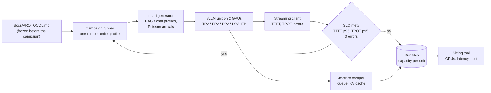
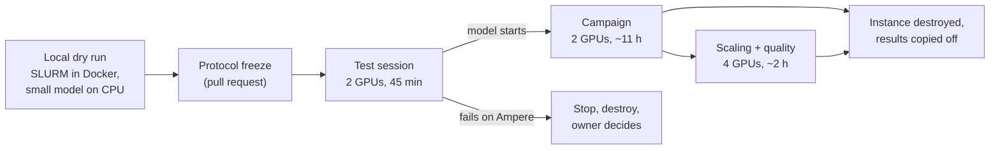

# hpc-inference-sizing

[](https://github.com/gabrielkpo/hpc-inference-sizing/actions/workflows/ci.yml)
[](https://github.com/gabrielkpo/hpc-inference-sizing/releases)
[](LICENSE)

Size the GPU fleet that serves an open-weight LLM for a client, from **measurements on real
multi-GPU hardware**: how many GPUs a latency target needs, and what latency a fixed GPU budget
gives. Model: Mistral Small 4 (MoE, 119B parameters), served with vLLM on rented 2- and 4-GPU nodes.

> **Status: done.** The protocol was frozen on 2026-11-11 ([`docs/PROTOCOL.md`](docs/PROTOCOL.md),
> deviations as dated amendments A1 to A11). The 2-GPU campaign (18 runs) and the 4-GPU session
> (4 runs) ran on 2026-11-11 to 13 for 24.25 USD in all; the results are in
> [`docs/RESULTS.md`](docs/RESULTS.md) and summarized [below](#results).

## Why

An organisation that hosts a model on its own GPUs must size the hardware before buying it: too
few GPUs and the assistant is too slow to use, too many and idle cards cost tens of thousands of
euros a year. Vendor benchmarks report peak throughput, which answers neither question a client
asks:

- a **public administration** buying GPUs for a document assistant used by 20,000 agents:
  *how many GPUs, at minimum, for a first token in under 2 s, and what does 1 s cost?*
- a **defence ministry** with a fixed, isolated fleet: *with 8 GPUs, what latency do users get,
  and how many can work at once before it breaks?*

Both clients are fictional; their sizes were fixed with the protocol
([§3.2](docs/PROTOCOL.md#32-arrivals-and-users)). Both are answered from one measured quantity:
the **capacity of a serving unit under a latency target**.

## How it works

Measurement path.



Campaign lifecycle: nothing is rented until the same jobs have run locally.



**Technical choices and their trade-offs**

- **Mistral Small 4 rather than a 24B dense model**: its 70.8 GB of NVFP4 weights do not fit on
  one 48 GB card, so multi-GPU is required. The cost: FP4 runs through weight-only kernels on
  Ampere ([ADR 0001](docs/adr/0001-mistral-small-4-on-two-a40.md)).
- **2 × A40 on Vast.ai rather than H100s**: 1.2 to 1.5 $/h for 96 GB of GPU memory kept the study
  at about 24 USD. The numbers will not match an H100 node; the method will.
- **Capacity under an SLO rather than peak throughput**: a client buys latency; peak throughput
  comes with queues no user would accept.
- **Measure one unit, extrapolate, then check on 4 GPUs** rather than every fleet size: the budget
  allows one 4-GPU check, where extrapolation is most likely to break.
- **SLURM for the local dry run, one chained process on the rented node**, because the levers and
  repeats depend on earlier runs ([ADR 0002](docs/adr/0002-slurm-jobs-local-and-rented.md),
  [ADR 0003](docs/adr/0003-campaign-runs-as-one-chained-process.md)).
- **Protocol frozen before the campaign**: hypotheses and pass criteria first, deviations as
  dated amendments, refuted hypotheses published like confirmed ones.

## Results

Capacity of one 2-GPU unit (req/s) on the RAG profile (6,100 input and 300 output tokens) and on
chat (500 and 300), highest 3-minute step with TTFT p95 under the target and TPOT p95 under 67 ms.
A star marks a capacity above a lower step that failed the same target (noise-level).

| Unit | RAG, T = 1 s | RAG, T = 2 s | RAG, T = 3 s | Chat, any target |
|---|---|---|---|---|
| TP2 | unreachable | 0.531 | 0.531 | 2.58 |
| EP2 | unreachable | 0.5 | 0.75\* | 2.45 |
| PP2 | unreachable | 0.5 | 0.5 | 1.56 |
| DP2+EP | unreachable | 0.4375 | 0.5\* | 2.17 |
| Two TP2 units behind nginx (4 GPUs, one run) | 0.5 | 1.39 | 1.39 | not measured |

Repeated with new arrivals, RAG holds **0.375 to 0.5 req/s at 2 to 3 s** on every unit. For the administration (2,000 active agents, RAG, 2 s) the
sizing tool gives **108 to 160 GPUs** (48,000 to 71,000 USD a month); 1 s needs units behind a
balancer and **about 250 to 500 GPUs** (its one step passed by 20 ms). The defence ministry's 8
GPUs serve about 100 to 150 users on RAG, 760 to 800 on chat.

| Hypothesis (criteria frozen before the runs) | Verdict |
|---|---|
| H1 the price of latency is non-linear | Not resolved on 2-GPU units; supported behind a balancer (one run) |
| H2 the best split depends on the target | Not resolved; its mechanism refuted (TPOT limits everywhere, not cache space) |
| H3 vLLM settings add ≥ 20 % | Not resolved (finer than the noise); prefix caching off clearly costs |
| H4 two units give ≥ 1.8 × one | Confirmed, 2.2 to 2.8 × at 2 s (one run); 1.85 × at 3 s |
| H5 NVFP4 loses ≤ 2 F1 points against FP8 | Confirmed: +0.42 F1, 95 % interval −1.83 to +2.74 (200 PIAF questions) |
| H6 the memory model is within 10 % | Refuted: within 5.3 % for three units, 32.7 % off for DP2+EP |

The summaries behind every number are in [`docs/results/`](docs/results/), with the sha256 of the
unpublished raw files. The tool reproduces the figures:

```bash
uv run hpc-sizing size --profile rag --target 2 --users 2000     # 108 / 160 GPUs
uv run hpc-sizing size --profile chat --target 2 --gpus 8        # users on a fixed fleet
uv run hpc-sizing size --summary docs/results/a40-x4.json --units two --gpus-per-unit 4 \
  --target 1 --users 2000                                        # pairs behind a balancer
uv run hpc-sizing results quality-diff                           # H5 interval
```

## Run it

Prerequisites: Python 3.12 and [uv](https://docs.astral.sh/uv/). No GPU is needed: the tests use
an in-memory fake server and download nothing.

```bash
git clone https://github.com/gabrielkpo/hpc-inference-sizing.git
cd hpc-inference-sizing
uv sync --locked --group dev
uv run pytest
uv run hpc-sizing memory --gpu a40 --gpus 2 --split pp   # predicted KV-cache capacity
```

GPU runs read `VAST_API_KEY` from the environment (see `.env.example` and
[`docs/VAST.md`](docs/VAST.md)).

## Project structure

| Path | Content |
|---|---|
| `docs/` | [Protocol](docs/PROTOCOL.md), [results](docs/RESULTS.md), memory model, bench, campaign, rental, test session, [decision records](docs/adr/) |
| `docs/results/` | Summaries of the run files and the cost of each session |
| `src/hpc_inference_sizing/` | Memory calculator, measurement bench (`bench/`), campaign runner and chain, quality runs, follow from the laptop, run-file summaries, sizing tool, Vast.ai driver, `hpc-sizing` command |
| `campaign/` | Campaign matrices: 2 × A40, 4 × A40, test session, dry runs |
| `slurm/` | Local SLURM cluster in Docker for dry runs |
| `scripts/` | Node setup, two units behind nginx, checkpoint header reader, detached runner |
| `tests/` | pytest suite |

## Data and privacy

No personal data. Prompts are built from **PIAF** (Etalab, `AgentPublic/piaf`, MIT), a public
French question-answering dataset downloaded at run time. Weights are downloaded on the rented
node only. API keys live in the environment; gitleaks scans the full history.

## Limitations / next

- **One GPU class, one host.** A40s over PCIe 4.0; the numbers do not transfer to H100 or B200
  nodes with NVLink. Ampere has no FP4 tensor cores, which likely raises the prefill time behind
  the 1 s results.
- **Synthetic traffic.** Poisson arrivals with fixed lengths are smoother than real peaks.
- **Single runs on 4 GPUs.** The balancer gain and the cost of 1 s rest on one run each, and the
  1 s step passed by 20 ms; the 2-GPU capacities carry the repeat range.
- **Before another campaign:** pin the node bootstrap, weights and image; save each step as it
  is measured; validate matrices before paid time; copy results incrementally; keep retrying a
  failed destroy; repeat both compared units (H2, H3); scrape `/metrics` per unit; harden ssh
  and the dry-run containers.

## Development

```bash
uv sync --locked --group dev
uv run pre-commit install      # ruff (through uv), gitleaks and a 10 MB file limit on every commit
uv run ruff check . && uv run ruff format --check . && uv run pytest
```

Every change is a reviewed pull request with a Conventional Commits title, merged by squash into
a protected `main`. CI runs ruff, pytest, a full-history gitleaks scan, CodeQL and a PR title
check; release-please cuts the releases.

## License

[MIT](LICENSE). Model weights are Mistral AI's, under Apache 2.0; PIAF questions are under MIT.
