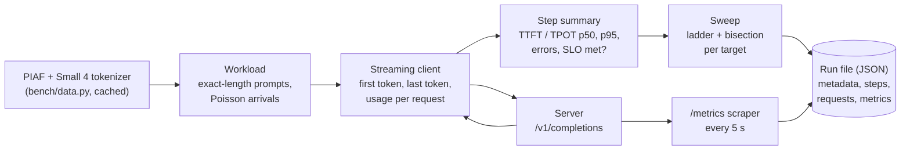

# Measurement bench

The bench measures how much load one serving unit sustains under the latency targets of
[`PROTOCOL.md`](PROTOCOL.md). It only talks to an OpenAI-compatible `/v1/completions` endpoint,
so the same commands run against a small model on a laptop (llama.cpp) and against vLLM on rented
GPUs. Code: [`src/hpc_inference_sizing/bench/`](../src/hpc_inference_sizing/bench/).



## Commands

```bash
uv run hpc-sizing bench fetch                      # PIAF and the tokenizer, into ~/.cache
uv run hpc-sizing bench step  --url http://localhost:8000 --model M --rate 1 --step-duration 180
uv run hpc-sizing bench sweep --url http://localhost:8000 --model M --profile rag \
    --targets 1 2 3 --output results/<run>.json --meta gpu=2xA40 --meta split=tp
```

`--meta KEY=VALUE` adds what the bench cannot see itself (GPU, split, vLLM version and flags, image
digest, host) to the run file. An existing run file is never overwritten without `--overwrite`.

A step lasts `--step-duration` seconds, and longer at low rates so that at least `--min-requests`
requests (default 20) are expected: a step with a handful of requests measures nothing.
`--tpot-bound-ms` is the protocol's 66.7 ms by default; it is changed only for dry runs on hardware
that cannot reach it, and the value used is written in the run file.

## What each part does

| Part | Behaviour |
|---|---|
| `workload.py` | RAG prompts of exactly 6,100 tokens (shared 1,000-token system prompt, 5 passages of 1,000 tokens assembled from consecutive PIAF contexts, a 100-token question), chat prompts of 500 tokens; lengths counted with Mistral's tokenizer (`mistral-common`, Small 4 `tekken.json`); request `i` is the same for a given seed |
| `client.py` | One streaming request asks for exactly 300 tokens (`max_tokens` = `min_tokens`, end of sequence ignored); time to first token = first non-empty chunk; time per output token = (last chunk - first chunk) / (tokens - 1), tokens from the final `usage` chunk (or one per chunk when the server sends none) |
| `stats.py` | p50 and p95 with linear interpolation; a step meets target T when TTFT p95 <= T, TPOT p95 <= 1/15 s and no request failed |
| `sweep.py` | Ladder 0.25, 0.5, 1, 2 ... req/s until the loosest target breaks, then 2 bisection steps per target; a rate is never measured twice |
| `scrape.py` | `/metrics` read during each step, keeping only `vllm:` and `llamacpp:` series |
| `runner.py` | Builds a step's prompts first, then runs the step with the scraper in parallel on one time origin, and writes the run file atomically (complete or absent); the host is recorded only when given with `--meta host=...` |

Known cost: prompts are built before each step (about 20 ms per RAG prompt), so a fast step at
8 req/s waits about 30 s before it starts; over a campaign this is a few minutes of idle GPU.

## Local dry runs

On a laptop the bench runs against `llama-server` and a small Mistral model (Ministral 3 3B,
Q4_K_M) with short steps. **These runs check the code path only: no number measured on a laptop
enters the results.**

```bash
llama-server -m models/Ministral-3-3B-Instruct-2512-Q4_K_M.gguf --port 8091 -c 13312 \
    --parallel 2 --metrics -ngl 99 --alias ministral-3b
uv run hpc-sizing bench sweep --url http://127.0.0.1:8091 --model ministral-3b --profile chat \
    --step-duration 20 --min-requests 6 --targets 10 30 --start-rate 0.1 --max-rate 0.8 \
    --tpot-bound-ms 300 --output runs/scratch/mac-chat-sweep.json
```

First dry run (2026-11-11, MacBook Air M1, llama.cpp b12110): 12 requests, no error; the server
counted 501 prompt tokens (the 500 requested plus its beginning-of-sequence token), so Ministral 3
shares the Small 4 vocabulary; every answer had exactly 300 tokens, so llama.cpp honours
`min_tokens` and `ignore_eos`; 45 `/metrics` samples (`llamacpp:*`) were recorded.
