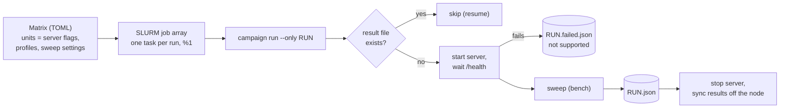

# Campaign

A campaign runs every (serving unit, profile) pair of a matrix, one after the other, on one node.
It is the path from the bench ([`BENCH.md`](BENCH.md)) to the result files, and it is the same on
a laptop, on the local SLURM cluster and on the rented GPU node.



## Matrices

| File | Purpose |
|---|---|
| [`campaign/a40-x2.toml`](../campaign/a40-x2.toml) | Main campaign, protocol §5.1 and §6: TP2, EP2, PP2, DP2+EP x RAG, chat on 2 x A40, served by vLLM |
| [`campaign/test-session.toml`](../campaign/test-session.toml) | Test session, protocol §10: TP2 x RAG, a short ladder, same server command as the campaign; checks the path on the real node |
| [`campaign/local-dryrun.toml`](../campaign/local-dryrun.toml) | Laptop dry run: the runner starts and stops llama.cpp itself for two units |
| [`campaign/slurm-dryrun.toml`](../campaign/slurm-dryrun.toml) | Local SLURM cluster dry run: jobs in containers, llama.cpp running on the host |

A unit is a set of server flags. `{model}` and `{flags}` are substituted in the server command;
an empty command means the server is already running.

## Commands

```bash
uv run hpc-sizing campaign list   --matrix campaign/a40-x2.toml
uv run hpc-sizing campaign status --matrix campaign/a40-x2.toml
uv run hpc-sizing campaign run    --matrix campaign/a40-x2.toml \
    --max-hours 11 --budget-usd 15 --price-per-hour 1.07 --meta gpu=2xA40 --meta host=vast-12345
```

- **Resume.** A run whose result file exists is skipped, so an interrupted campaign is restarted
  with the same command.
- **Failure is a result.** A unit whose server does not become healthy, or a run that crashes
  during the sweep, is written to `RUN.failed.json` with the stage (`start` or `sweep`), the
  error and the server log path, and the campaign goes on; `--retry-failed` runs it again.
- **Stop rules.** Before each run, the campaign stops if `--max-hours` or `--budget-usd` is
  reached, and prints the amount spent after each run. A budget needs `--price-per-hour`. The
  campaign time is kept in `RESULTS_DIR/campaign-clock.json`, so the caps hold for a whole SLURM
  array (one process per run) and across a restart; delete the file to start a new budget.
- **Clean stop.** The server runs in its own process group, and the whole group is stopped after
  each run, so no worker keeps GPU memory for the next unit.
- **Results leave the node** after each run when the matrix sets `sync_command`.

## The whole 2-GPU matrix in one session (`--chain`)

The levers and the repeats depend on the base results, and the protocol keeps the whole 2-GPU
matrix on one host in one session (amendment A5). `campaign run --chain` therefore runs four
phases on the same node, deriving each from the run files with fixed rules
([`chain.py`](../src/hpc_inference_sizing/chain.py)):

| Phase | Runs | Rule |
|---|---|---|
| Base | every unit x profile (8) | §5.1 |
| Levers | 7, RAG profile | on the best unit: highest capacity at T = 2 s on RAG, ties broken by the looser targets (1.5 s is stricter, so 3 s); if no unit reaches 2 s, the next looser target. One lever at a time (`max_num_seqs` 32, 64, 128; `max_num_batched_tokens` 2,048, 8,192, 16,384; prefix caching off), each ladder starting at a quarter of the baseline capacity, two doubling steps below it (§5.2) |
| Best combination | 0 or 1 | the value of each lever that raised the capacity at that target above the baseline, combined, one full ladder (it reads every target); none if no lever helped, the defaults being already measured (§5.2) |
| Repeats | 1 per profile | on the best unit of each profile, its capacity point for each reachable target, measured 3 more times at that rate (§6.6) |

These rules are how the chain reads §5.2 and §6.6 of the frozen protocol; where the protocol is
silent (tie-breaks, a 2 s target nobody reaches, which configuration is repeated) the choice
is written above and in `plan-<phase>.json` next to the results. The phase order is the cut
order of §10: at the time or budget cap, the repeats are lost first, then lever values, never the
base. Rerunning the same command resumes. The SLURM array (below) covers the base matrix only;
the chain runs its phases in one process.

## Following a long run

A campaign day lasts hours, so it is followed without watching a terminal:

- **Live log on the node.** The campaign writes one line per load step as soon as it is measured
  (rate, requests, errors, TTFT and TPOT p95, targets met) and one progress line per run (runs
  done out of the total, hours, spend). Output is line-buffered, so `tail campaign.log` is live
  even under `nohup`.
- **`campaign follow` on the laptop.** Every few minutes it copies the node's results folder into
  the local one (results leave the machine), reports each run that finished with its capacities,
  and appends events (`run_done`, `run_failed`, `unreachable`, `finished`, `destroyed`...) to
  `runs/events-NAME.jsonl`, outside the results folder where the node's files land. Only
  expected files are taken from the node (run files, failure records, plans, the campaign clock,
  server logs), and event text is made plain. When the campaign process has ended, on two looks in a row, and the
  results are copied, it destroys the instance: a finished campaign does not bill until the
  guard's deadline. A queued SLURM array task counts as running. When nothing happens it first
  raises an **alert** (an event, so a notification): the campaign has not started 30 minutes
  after the follow began (`--start-timeout-min`), or its log has not changed for 45 minutes while
  it runs (`--stall-timeout-min`; a first server start can stay silent up to 40 minutes). That
  leaves time to look and repair; if nothing changes for 30 more minutes (`--alert-grace-min`),
  it destroys the instance. A campaign that moves again clears the alert. `--alert-only` keeps
  the node whatever happens; `--no-destroy` turns every destroy off, the end of campaign
  included.
- **Detached from the Claude app.** [`scripts/detached.sh`](../scripts/detached.sh) starts the
  guard and the follow in their own session, with a log file, and keeps the Mac awake while they
  run (plugged in, lid open), so a closed window or a crashed app does not stop them. The
  backstop inside the instance still covers a laptop that dies.
- **Notifications.** The Claude session reads the events file and sends each event to the owner's
  phone; nothing leaves the laptop through the scripts themselves.

```bash
scripts/detached.sh runs/follow.log uv run --env-file .env hpc-sizing campaign follow \
    --matrix campaign/a40-x2.toml --instance ID --every 300
tail -f runs/follow.log
```

## SLURM (ADR 0002)

The same job array runs on the local cluster and on the rented node.

```bash
# Local cluster (laptop): controller + two nodes in Docker, the repository mounted at /work
docker compose -f slurm/docker-compose.yml up -d --build
docker compose -f slurm/docker-compose.yml exec slurmctld bash -c "cd /work && slurm/submit.sh campaign/slurm-dryrun.toml"
docker compose -f slurm/docker-compose.yml exec slurmctld squeue

# Rented node: single-node SLURM in the container, then the same submission
bash slurm/single-node.sh
slurm/submit.sh campaign/a40-x2.toml --max-hours 11 --budget-usd 15 --price-per-hour 1.07
```

`slurm/submit.sh` submits one array task per run with the `%1` throttle (a node serves one model
at a time). If SLURM does not come up on the rented node, the campaign runs directly with
`hpc-sizing campaign run`: nothing is debugged on paid time.

## Dry runs done

Both checked the path, not performance. No number from them enters the results.

| Dry run | What it showed |
|---|---|
| Laptop, `local-dryrun.toml` | The runner starts llama.cpp for each unit, waits for `/health` (2 to 4 s), sweeps, writes the run file and stops the server; nothing left running |
| Local SLURM, `slurm-dryrun.toml` | Two array tasks run one after the other on the same node (`JobArrayTaskLimit` holds the second), each writes its run file, the status ends at 2 done, 0 failed, 0 pending |

Notes for the local cluster:

- The compute containers need `CAP_SYS_ADMIN`: slurmd starts each job step with `clone(2)` and
  namespace flags, which Docker's default seccomp profile refuses
  (`fatal: clone: Operation not permitted`).
- On an 8 GB laptop, the Docker VM, llama.cpp and the desktop apps together exhaust memory. Run
  one compute node (`docker compose stop c2` and drain it), a small llama.cpp context
  (`-c 4096 --parallel 1`), and stop everything right after the dry run.
- With one llama.cpp slot, each chat request takes about 20 s, so even 0.1 req/s queues up and
  no target is met (capacity `None`). That is the expected result of an overloaded server, and
  it exercises the "no rate passes" branch of the sweep.
