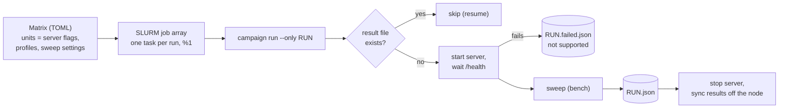

# Campaign

A campaign runs every (serving unit, profile) pair of a matrix, one after the other, on one node.
It is the path from the bench ([`BENCH.md`](BENCH.md)) to the result files, and it is the same on
a laptop, on the local SLURM cluster and on the rented GPU node.



## Matrices

| File | Purpose |
|---|---|
| [`campaign/a40-x2.toml`](../campaign/a40-x2.toml) | Main campaign, protocol §5.1 and §6: TP2, EP2, PP2, DP2+EP x RAG, chat on 2 x A40, served by vLLM |
| [`campaign/test-session.toml`](../campaign/test-session.toml) | Test session, protocol §10: TP2 x RAG, a short ladder, same server command as the campaign; checks the path on the real node |
| [`campaign/local-dryrun.toml`](../campaign/local-dryrun.toml) | Laptop dry run: the runner starts and stops llama.cpp itself for two units |
| [`campaign/slurm-dryrun.toml`](../campaign/slurm-dryrun.toml) | Local SLURM cluster dry run: jobs in containers, llama.cpp running on the host |

A unit is a set of server flags. `{model}` and `{flags}` are substituted in the server command;
an empty command means the server is already running.

## Commands

```bash
uv run hpc-sizing campaign list   --matrix campaign/a40-x2.toml
uv run hpc-sizing campaign status --matrix campaign/a40-x2.toml
uv run hpc-sizing campaign run    --matrix campaign/a40-x2.toml \
    --max-hours 11 --budget-usd 15 --price-per-hour 1.07 --meta gpu=2xA40 --meta host=vast-12345
```

- **Resume.** A run whose result file exists is skipped, so an interrupted campaign is restarted
  with the same command.
- **Failure is a result.** A unit whose server does not become healthy, or a run that crashes
  during the sweep, is written to `RUN.failed.json` with the stage (`start` or `sweep`), the
  error and the server log path, and the campaign goes on; `--retry-failed` runs it again.
- **Stop rules.** Before each run, the campaign stops if `--max-hours` or `--budget-usd` is
  reached, and prints the amount spent after each run. A budget needs `--price-per-hour`. The
  campaign time is kept in `RESULTS_DIR/campaign-clock.json`, so the caps hold for a whole SLURM
  array (one process per run) and across a restart; delete the file to start a new budget.
- **Clean stop.** The server runs in its own process group, and the whole group is stopped after
  each run, so no worker keeps GPU memory for the next unit.
- **Results leave the node** after each run when the matrix sets `sync_command`.

## SLURM (ADR 0002)

The same job array runs on the local cluster and on the rented node.

```bash
# Local cluster (laptop): controller + two nodes in Docker, the repository mounted at /work
docker compose -f slurm/docker-compose.yml up -d --build
docker compose -f slurm/docker-compose.yml exec slurmctld bash -c "cd /work && slurm/submit.sh campaign/slurm-dryrun.toml"
docker compose -f slurm/docker-compose.yml exec slurmctld squeue

# Rented node: single-node SLURM in the container, then the same submission
bash slurm/single-node.sh
slurm/submit.sh campaign/a40-x2.toml --max-hours 11 --budget-usd 15 --price-per-hour 1.07
```

`slurm/submit.sh` submits one array task per run with the `%1` throttle (a node serves one model
at a time). If SLURM does not come up on the rented node, the campaign runs directly with
`hpc-sizing campaign run`: nothing is debugged on paid time.

## Dry runs done

Both checked the path, not performance. No number from them enters the results.

| Dry run | What it showed |
|---|---|
| Laptop, `local-dryrun.toml` | The runner starts llama.cpp for each unit, waits for `/health` (2 to 4 s), sweeps, writes the run file and stops the server; nothing left running |
| Local SLURM, `slurm-dryrun.toml` | Two array tasks run one after the other on the same node (`JobArrayTaskLimit` holds the second), each writes its run file, the status ends at 2 done, 0 failed, 0 pending |

Notes for the local cluster:

- The compute containers need `CAP_SYS_ADMIN`: slurmd starts each job step with `clone(2)` and
  namespace flags, which Docker's default seccomp profile refuses
  (`fatal: clone: Operation not permitted`).
- On an 8 GB laptop, the Docker VM, llama.cpp and the desktop apps together exhaust memory. Run
  one compute node (`docker compose stop c2` and drain it), a small llama.cpp context
  (`-c 4096 --parallel 1`), and stop everything right after the dry run.
- With one llama.cpp slot, each chat request takes about 20 s, so even 0.1 req/s queues up and
  no target is met (capacity `None`). That is the expected result of an overloaded server, and
  it exercises the "no rate passes" branch of the sweep.
