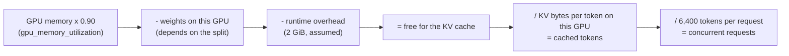

# Memory model and the H6 prediction

This page records **how the memory calculator works** and **what it predicts, before any GPU is
rented**. Hypothesis H6 in [`PROTOCOL.md`](PROTOCOL.md) compares these predictions with the
KV-cache size vLLM reports at start-up. The predictions below are not edited after the first
measurement; corrections go in a dated section at the end.

Run it: `uv run hpc-sizing memory --gpu a40 --gpus 2 --split pp` (code:
[`src/hpc_inference_sizing/memory.py`](../src/hpc_inference_sizing/memory.py)).

## What fills a GPU

## Inputs

| Input | Value | Source |
|---|---|---|
| Weights by component | Mistral Small 4 NVFP4: 70.80 GB (routed experts 65.23, attention 2.02, embedding 1.07, output head 1.07, vision 0.86, shared expert 0.51, router 0.04). FP8: 120.92 GB | Safetensors headers of the Hugging Face checkpoints, read by [`scripts/measure_checkpoint.py`](../scripts/measure_checkpoint.py), stored in `src/hpc_inference_sizing/data/` |
| KV cache per token | 640 bytes per layer, 36 layers: 23.0 KB for the whole model | MLA caches one latent of 256 + 64 values per token and layer, in bf16 (`params.json`) |
| GPU memory | A40 and L40S 46,068 MiB, RTX A6000 49,140 MiB, H100 PCIe 81,559 MiB | nvidia-smi totals; A40 and A6000 from Vast.ai listings, L40S and H100 to confirm on the first run |
| Memory vLLM may use | 90 % | vLLM default `gpu_memory_utilization` |
| Runtime overhead | 2 GiB per GPU | **Assumption** (activations, CUDA graphs, CUDA context); vLLM measures it at start-up |
| Request size | 6,400 tokens (6,100 in, 300 out) | RAG profile, protocol §3.1 |

## The split rules

| Split | Weights on each GPU | KV cache on each GPU | Unit capacity |
|---|---|---|---|
| `single` | everything | all 36 layers | that GPU |
| `tp` (tensor parallel) | every layer cut in two; router, norms and vision copied | all 36 layers, **copied**: the MLA latent cannot be split by attention heads | the same tokens on both GPUs |
| `ep` (attention cut, experts spread) | same bytes as `tp`; experts are placed whole instead of cut | all 36 layers, copied | as `tp` |
| `pp` (pipeline) | 18 consecutive layers each; embedding and vision on the first GPU, output head on the last | **only its own 18 layers** | the fuller GPU sets the limit |
| `dp_ep` (attention copied, experts spread) | attention, shared expert, embedding and output head copied; routed experts spread | all 36 layers, but **only its own requests** | the two GPUs add up |

Assumptions to check on the first run: vision encoder and norms copied on every GPU; vLLM keeps a
full copy of the MLA cache on every tensor-parallel rank (read in the code, not measured).

## Predictions (written 2026-11-10, before any measurement)

Mistral Small 4, default inputs above.

| Model | GPUs | Split | Weights on the fullest GPU (GB) | Free for cache, smallest (GB) | KV per token on a GPU (KB) | Unit cache (tokens) | Concurrent RAG requests |
|---|---|---|---|---|---|---|---|
| NVFP4 | 2 x A40 | `tp` | 35.85 | 5.48 | 23.0 | 237,808 | 37 |
| NVFP4 | 2 x A40 | `ep` | 35.85 | 5.48 | 23.0 | 237,808 | 37 |
| NVFP4 | 2 x A40 | `pp` | 35.83 | 5.50 | 11.5 | 477,281 | 74 |
| NVFP4 | 2 x A40 | `dp_ep` | 38.19 | 3.14 | 23.0 | 272,632 | 42 |
| NVFP4 | 1 x H100 PCIe | `single` | 70.80 | 4.02 | 23.0 | 174,448 | 27 |
| NVFP4 | 1 x A40 | `single` | 70.80 | does not fit | — | — | — |
| FP8 | 4 x A40 | `tp` | 30.90 | 10.43 | 23.0 | 452,498 | 70 |

What these predictions say:

- **Splitting by layers (`pp`) holds about twice the tokens of cutting every layer (`tp`)**,
  because each GPU caches only its own layers.
- **`dp_ep` gains less than expected (+15 % over `tp`, not 2x).** Each GPU caches only its own
  requests, but copying the attention, shared expert, embedding and output head costs about
  2.3 GB per GPU, which comes out of the cache.
- **`ep` uses the same memory as `tp`.** The difference between them is communication and speed,
  not memory.
- **One H100 holds the model with less cache than two A40s** (27 requests against 37 to 74).

## How H6 is checked

At start-up vLLM logs the KV-cache size it allocated, in tokens. For each configuration, the
measured value is compared with the "unit cache" column; H6 passes if every configuration is within
10 %. The 2 GiB overhead is the least certain input: the measured overhead is recorded next to each
result so that a miss can be traced to its cause.

## Corrections

None yet.
